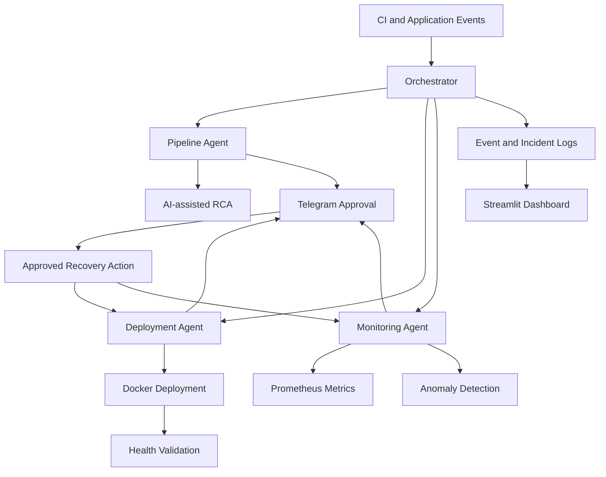

# Agentic AI-Based DevOps Automation Platform

An experimental multi-agent DevOps automation platform designed to assist with CI failure analysis, deployment validation, monitoring, and recovery workflows through AI-assisted agents and human approval.

> **Project status:** B.Tech minor-project prototype. This repository demonstrates selected workflows in a controlled environment and is not production-ready.

## Overview

DevOps teams frequently need to investigate CI failures, deploy new versions, monitor application health, and respond to operational incidents. This project explores how specialized agents can assist with these tasks while keeping human approval in the loop for selected operational actions.

The platform integrates a sample application, CI testing, Docker-based deployment, Prometheus metrics, AI-assisted analysis, approval-based recovery, and a dashboard for viewing recorded events.

## Features

- **Pipeline Agent:** Uses CI failure information to generate AI-assisted root-cause explanations.
- **Deployment Agent:** Deploys containerized releases and validates application health.
- **Health checks and rollback:** Checks release health and supports reverting to a previously healthy release.
- **Monitoring Agent:** Collects and evaluates configured application metrics for selected anomalies.
- **Recovery workflows:** Supports approval-based restart and rollback operations.
- **Human-in-the-loop:** Uses Telegram approval interactions for selected risky actions.
- **Orchestration:** Routes events and requests to the relevant agent or workflow.
- **Dashboard and audit logs:** Displays project activity and recorded incident/deployment information.
- **Prometheus monitoring:** Collects application metrics for monitoring workflows.

## Architecture



## Technology Stack

- **Language:** Python
- **Application:** Flask
- **Containerization:** Docker and Docker Compose
- **CI:** GitHub Actions
- **Monitoring:** Prometheus
- **Dashboard:** Streamlit
- **Approval interface:** Telegram Bot
- **Testing:** pytest
- **AI-assisted analysis:** LLM integration

## Repository Structure

```text
agentic-devops/
├── .github/workflows/        # CI workflow configuration
├── agent/                    # Agent logic and automation
├── app/                      # Sample Flask application
├── dashboard/                 # Streamlit dashboard
├── eval/                      # Evaluation-related assets
├── monitoring/                # Monitoring configuration
├── tests/                     # Automated tests
├── .env.example
├── Dockerfile
├── docker-compose.yml
├── docker-compose.monitoring.yml
├── requirements-dev.txt
├── requirements-phase5.txt
├── requirements-phase6.txt
├── pytest.ini
├── test_llm.py
└── test_models.py
```

## Prerequisites

- Python 3.11 (or the compatible version configured in the project)
- Git
- Docker Desktop and Docker Compose
- PowerShell on Windows (or a compatible shell)
- API credentials for AI features, if enabled
- Telegram bot credentials, if Telegram approval is enabled

## Setup

### 1. Clone the repository

```bash
git clone https://github.com/Princeyadavakd/agentic-devops.git
cd agentic-devops
```

### 2. Create a virtual environment

**Windows (PowerShell):**

```powershell
python -m venv venv
venv\Scripts\activate
```

**Linux/macOS:**

```bash
python3 -m venv venv
source venv/bin/activate
```

### 3. Install dependencies

```bash
pip install -r requirements-dev.txt
```

Install any additional requirements files needed by specific features or phases.

### 4. Configure environment variables

Copy `.env.example` to `.env` and configure the required values for the features you plan to run.

**Do not commit API keys, tokens, passwords, or other secrets to the repository.**

### 5. Run tests

```bash
pytest -v
```

## Run the Application

Build and run the application using Docker Compose:

```bash
docker compose up --build
```

The sample application is available at:

- `http://localhost:5000/`
- `http://localhost:5000/health`
- `http://localhost:5000/users/1`
- `http://localhost:5000/metrics`

Stop the stack:

```bash
docker compose down
```

## Fault-Injection Modes

The sample application supports selected fault modes used to demonstrate monitoring and recovery behavior.

**Windows PowerShell examples:**

```powershell
$env:BUG_MODE="crash"; docker compose up -d --build
$env:BUG_MODE="leak";  docker compose up -d --build
$env:BUG_MODE="slow";  docker compose up -d --build
$env:BUG_MODE="none";  docker compose up -d --build
```

These modes are intended for controlled demonstrations and testing, not for use in production.

## Monitoring with Prometheus

Start the monitoring stack:

```bash
docker compose -p monitoring -f docker-compose.monitoring.yml up -d
```

Prometheus:

- Web UI: `http://localhost:9090`
- Targets page: `http://localhost:9090/targets`

Prometheus is used to collect configured application metrics and support the monitoring workflows. The project explores signals such as service availability, memory usage, error rate, and latency, subject to the implemented metric collection and detection logic.

## Dashboard

The Streamlit dashboard provides a visual view of recorded project events, including deployment activity, monitoring incidents, and evaluation-related information.

Refer to the dashboard implementation and configuration in the `dashboard/` directory for the launch command and available views.

## Human-in-the-Loop Approval Workflow

Selected operational actions are gated by human approval:

1. An agent identifies an issue or proposes an operational action.
2. The workflow creates an action request.
3. The request is sent through the configured approval channel.
4. The user approves or rejects the request.
5. An approved action is executed, where supported.
6. The result is logged for auditing and dashboard display.

The approval mechanism is intended to demonstrate controlled automation rather than unrestricted autonomous operations.

## Demonstration Scenarios

- **CI failure analysis:** A failing test or pipeline log is analyzed to generate an AI-assisted explanation.
- **Unhealthy deployment:** Health validation detects an unsuccessful release and the rollback workflow can restore a previously healthy version.
- **Service-down recovery:** Monitoring detects service unavailability and supports an approval-based recovery action.
- **Fault injection:** Configured fault modes help demonstrate health checks, detection, and recovery workflows.

## Evaluation

The prototype was evaluated through a limited set of repeated demonstration runs. These figures are experimental observations and should not be treated as a statistically robust benchmark.

| Scenario | Agent mean | Manual mean | Sample size |
|---|---:|---:|---|
| Crash rollback | 28.9 s | 22.3 s | Agent: 5; Manual: 4 |
| Service-down restart | 28.6 s | 10.4 s | Agent: 3; Manual: 3 |
| Memory-leak recovery | 102 s | Not measured | Agent: 3 |
| CI root-cause analysis | 31.2 s | 93.8 s | Agent: 5; Manual: 2 |

Recorded root-cause analysis accuracy was **20% (1 correct case out of 5 analyzed cases)**. This indicates that the AI-assisted diagnostic component needs substantial improvement and validation.

Results depend on the test environment, implementation, and limited sample size.

## Limitations

- This is a student-scale prototype, not a production-grade DevOps platform.
- The evaluation covers a limited number of scenarios and runs.
- AI-generated explanations can be inaccurate.
- Recovery and monitoring behavior is limited to implemented workflows and configured metrics.
- A production deployment would require stronger security controls, reliability engineering, broader testing, access controls, and operational safeguards.

## Future Work

- Improve AI-assisted root-cause analysis through better context and validation.
- Expand anomaly detection and monitoring coverage.
- Increase automated test coverage and repeatability of evaluation.
- Add stronger access controls and approval security.
- Integrate with additional CI/CD and deployment platforms.
- Evaluate the system with larger and more diverse test scenarios.

## Contributors

- Prince Yadav
- Sarthak Sharma

## License

No license has currently been specified. Add an open-source license if reuse, modification, or redistribution is intended.
